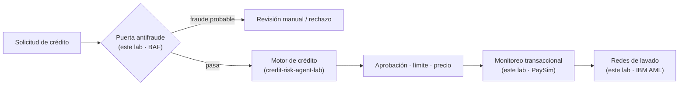
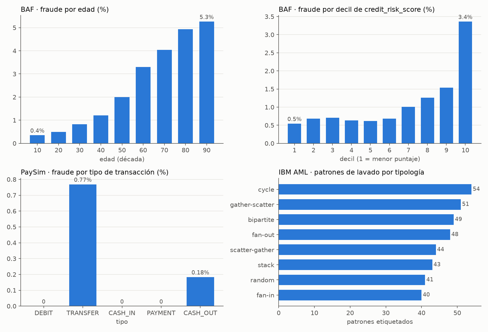
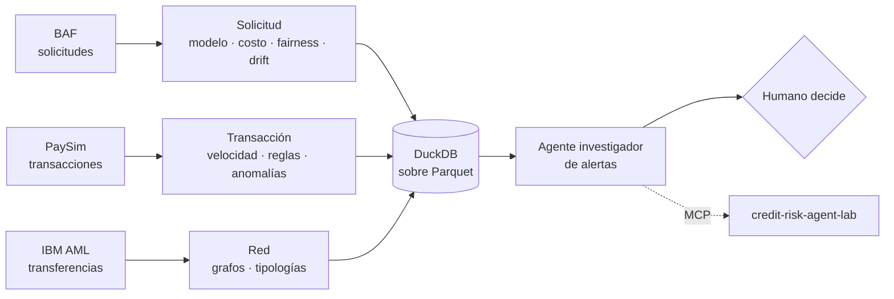

# fraud-agent-lab

> 🚧 v0.1 en construcción · Proyecto construido sesión a sesión, con cada decisión registrada en [docs/decisiones.md](docs/decisiones.md). · Repo 3 del portafolio: complementa [`credit-risk-agent-lab`](https://github.com/neiderolaya26/credit-risk-agent-lab) y [`marketing-agent-lab`](https://github.com/neiderolaya26/marketing-agent-lab).

- **Fecha de inicio:** 2026-11-13
- **Estado:** En curso (modo guiado: Neider decide y escribe las decisiones; Claude arma el esqueleto y explica)

## Pregunta de negocio (decisión 001)

¿Se puede, **solo con datos públicos**, construir un sistema antifraude de punta a punta, que **filtre solicitudes** antes del motor de crédito, **vigile las transacciones** y **encuentre redes de lavado**, medido en recall con 5% de falsos positivos y en **pérdida neta evitada**, sin castigar a un grupo de edad? ¿Y se puede hacer con un **agente investigador de alertas** que proponga y un humano que decida?

## Por qué un lab de fraude junto al de crédito

Lending Club no trae etiquetas de fraude, así que este lab usa otras fuentes. El hallazgo que lo justifica: **en fraude de solicitud, el riesgo sube con el puntaje de crédito.** En BAF el fraude es 0,5% en el decil de menor `credit_risk_score` y **3,4% en el más alto**, y llega al 13–20% en los límites propuestos más altos. El defraudador se presenta como un buen cliente, así que un modelo de PD lo aprobaría.



El enlace entre labs es por **agentes**: el agente de crédito podrá consultar el servidor MCP de este lab como una herramienta más. Las poblaciones no se cruzan, y cada resultado lo dice.

## Resultados hasta ahora



| Hallazgo | Cifra | Dónde |
|---|---|---|
| Fraude ≠ riesgo de crédito | Fraude 0,5% en el decil más bajo de `credit_risk_score` y 3,4% en el más alto | Notebook 01 |
| Fairness por edad | 0,4% de fraude a los 20 años y 5,3% a los 90; 2,3% en mayores de 50 contra 0,8% | Notebook 01 |
| PaySim | Solo hay fraude en `TRANSFER` (0,77%) y `CASH_OUT` (0,18%); la regla del simulador caza 16 de 8.213 | Notebook 01 |
| Lavado en redes | 370 patrones en 8 tipologías (ciclo, fan-in, fan-out…) cubren 3.209 de 5.177 transferencias de lavado | Notebook 01 |

## Datos

| Dataset | Momento del fraude | Tamaño | Licencia |
|---|---|---|---|
| [Bank Account Fraud](https://www.kaggle.com/datasets/sgpjesus/bank-account-fraud-dataset-neurips-2022) (Feedzai, [NeurIPS 2022](https://arxiv.org/abs/2211.13358)) | **Solicitud**: apertura de cuenta, con sesgos controlados por edad en 5 variantes | 6 × 1 M de solicitudes, 8 meses, 1,10% de fraude | CC BY-NC-SA 4.0 |
| [PaySim](https://www.kaggle.com/datasets/ealaxi/paysim1) | **Transacción**: dinero móvil simulado a partir de logs reales | 6,36 M de transacciones, 743 horas, 0,13% de fraude | CC BY-SA 4.0 |
| [IBM AML HI-Small](https://www.kaggle.com/datasets/ealtman2019/ibm-transactions-for-anti-money-laundering-aml) ([NeurIPS 2023](https://arxiv.org/abs/2306.16424)) | **Red**: transferencias entre cuentas con patrones de lavado etiquetados | 5,08 M de transferencias, 18 días, 0,10% de lavado | CDLA-Sharing 1.0 |

Las tres fuentes son **sintéticas** (generadas a partir de datos reales con GAN o simulación por agentes) y no traen datos de personas. Elliptic quedó fuera porque su licencia (CC BY-NC-ND) no permite publicar derivados.

## Hoja de ruta (tentativa)

| Sesión | Tema | Técnicas | Datos |
|---|---|---|---|
| 1 ✅ | Entorno, datos y pregunta de negocio (decisión 001: ciclo completo) | Ingesta a Parquet, DuckDB en memoria, muestras ponderadas, panorama (notebook 01) | Todas |
| 2 | Fraude de solicitud: línea base | Partición temporal (meses 0–5 / 6–7), logística vs. LightGBM, desbalance, recall @ 5% FPR | BAF |
| 3 | Costo y umbrales | Pérdida neta evitada, umbral óptimo, cola de revisión con capacidad limitada | BAF |
| 4 | Fairness | Brecha por edad (FPR, recall), las 5 variantes de sesgo, mitigación y su costo | BAF |
| 5 | Drift y monitoreo | PSI por variable y por mes, degradación del modelo, recalibración | BAF |
| 6 | Explicabilidad | SHAP, códigos de razón para el rechazo, revisión humana | BAF |
| 7 | Fraude transaccional | Features de velocidad y saldo, chequeo de fuga, partición temporal por hora | PaySim |
| 8 | Reglas + ML | Motor de reglas contra modelo, anomalías sin etiqueta (Isolation Forest) | PaySim |
| 9 | Lavado en grafos | Features de red (grado, ciclos, fan-in/out), modelo por cuenta | IBM AML |
| 10 | Tipologías | Detección de patrones y comunidades, recall por tipología | IBM AML |
| 11 | Agente investigador de alertas | LangGraph: SQL sobre DuckDB + modelos como herramientas + borrador de reporte + aprobación humana | Todas |
| 12 | Operación | Servidor MCP (lo consume el agente de crédito), registro de ejecuciones, evals | Todas |
| 13 | Caso de negocio | Recomendación de política antifraude, demo, README final, release v1.0.0 | Todas |



## Cómo reproducirlo

Requiere Python 3.12 o superior.

```bash
python -m venv .venv && .venv\Scripts\activate
pip install -r requirements.txt && pip install -e .
pytest                           # corre sin descargar nada: usa data/processed/
```

Para regenerar todo desde las fuentes (unos 2,3 GB de CSV; requiere un token de Kaggle):

```bash
kaggle datasets download sgpjesus/bank-account-fraud-dataset-neurips-2022 -p data/raw/baf --unzip
kaggle datasets download ealaxi/paysim1 -p data/raw/paysim --unzip
for f in HI-Small_Trans.csv HI-Small_accounts.csv HI-Small_Patterns.txt; do
  kaggle datasets download ealtman2019/ibm-transactions-for-anti-money-laundering-aml -f $f -p data/raw/ibm_aml --unzip
done

python -m fraud_lab.ingest       # 10 Parquet (zstd) en data/interim/, 659 MB
python -m fraud_lab.publicar     # 9 Parquet publicables en data/processed/, 46 MB
```

**Todo vive en Parquet**, sin una base de datos aparte: `fraud_lab.db.conectar()` abre DuckDB en memoria con una vista por archivo.

```python
from fraud_lab import db
con = db.conectar(db.PROCESSED)          # lo publicado; db.conectar() lee data/interim
db.consultar(con, "SELECT fraud_bool, sum(peso) AS solicitudes FROM baf_base_muestra GROUP BY 1")
```

`db.consultar()` es la puerta del agente: solo acepta una sentencia `SELECT` y la conexión solo puede leer su carpeta.

### Datos publicados en el repo (`data/processed/`)

Ver [data/processed/README.md](data/processed/README.md). En resumen: muestras estratificadas con **todos** los fraudes y una fracción fija de los casos sanos, con `peso` para reconstruir la población.

## Estructura

```
data/raw/          crudos descargados (no se suben)
data/interim/      Parquet completos de las tres fuentes (no se suben)
data/processed/    muestras ponderadas y derivados de cada sesión (se suben)
docs/              decisiones.md, imágenes
notebooks/         un notebook por sesión, con mis conclusiones
src/fraud_lab/     código del pipeline, modelos y agente
tests/             pruebas que no necesitan descargar datos
```

## Bitácora

- 2026-11-13: inicio. Decisión 001 (ciclo completo, BAF como eje, recall @ 5% FPR + pérdida neta evitada). Ingesta de BAF, PaySim e IBM AML a Parquet, muestras publicadas y notebook 01.
