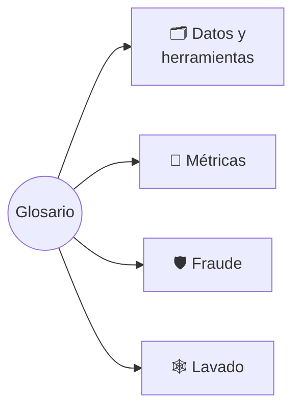
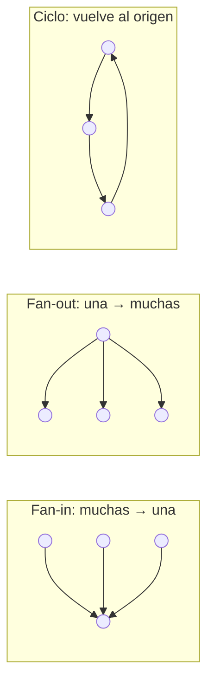

# 📖 Glosario

Términos del lab en palabras simples, agrupados por tema. Crece en cada sesión.

> 💳 = su equivalente en riesgo de crédito, cuando existe.

---

## 🗂️ Datos y herramientas

- **Datos sintéticos**  
  Datos generados por un modelo o un simulador que imitan los reales sin copiar a ninguna persona.

- **GAN** (red generativa adversaria)  
  Dos redes que compiten: una inventa filas falsas y la otra intenta detectarlas. Al final las inventadas parecen reales. Así se creó BAF.

- **BAF** (*Bank Account Fraud*)  
  Dataset de Feedzai (NeurIPS 2022): 1 M de solicitudes de cuenta bancaria online, 1,1% de fraude, 8 meses, 5 variantes con sesgo de edad.
  - 💳 Como Lending Club, pero la etiqueta es fraude en vez de mora.

- **PaySim**  
  Simulador de transacciones de billetera móvil (tipo Nequi o Yape) calibrado con registros reales de un país africano.

- **IBM AML**  
  Simulación de transferencias entre bancos con esquemas de lavado etiquetados (NeurIPS 2023).

- **Parquet**  
  Formato de archivo por columnas y comprimido: liviano y rápido de leer.

- **DuckDB**  
  SQL que corre dentro de Python y lee Parquet directo, sin servidor.

- **Muestreo estratificado con peso**  
  Guardar todos los casos raros y solo una fracción de los comunes; la columna `peso` reconstruye la población.
  - 💳 Como el factor de expansión de una encuesta.

---

## 📏 Métricas

- **FPR** (tasa de falsos positivos)  
  De cada 100 clientes buenos, a cuántos marca el modelo como sospechosos.
  - 💳 Buenos rechazados por el corte.

- **Recall** (sensibilidad)  
  De cada 100 fraudes, cuántos atrapa el modelo.

- **Recall @ 5% FPR**  
  Qué porcentaje del fraude atrapo si acepto molestar a 5 de cada 100 buenos.
  - 💳 Un punto concreto de la curva ROC.

- **Partición temporal**  
  Entrenar con el pasado y evaluar con meses posteriores.
  - 💳 *Out-of-time* (OOT).

- **Fairness**  
  Que el modelo no perjudique de más a un grupo protegido (aquí, mayores de 50).
  - 💳 Lo mismo que no discriminar por edad o género al otorgar.

---

## 🛡️ Fraude

- **Cuenta mula**  
  Cuenta abierta con identidad falsa o prestada para recibir y sacar plata de estafas.

- **Fricción**  
  La molestia al cliente bueno marcado por error: documentos, llamadas, bloqueo.
  - 💳 El buen cliente rechazado que se va a la competencia.

- **Variables de velocidad**  
  Cuántas solicitudes llegan en una ventana corta (6 h, 24 h, 4 semanas).
  - 💳 Consultas recientes al buró.

---

## 🕸️ Lavado

- **AML** (*anti-money laundering*)  
  Prevención del lavado de dinero: detectar plata ilegal que se mueve entre cuentas para que parezca legal.

- **Tipología**  
  "Forma" típica de un esquema de lavado. Las tres más simples:

