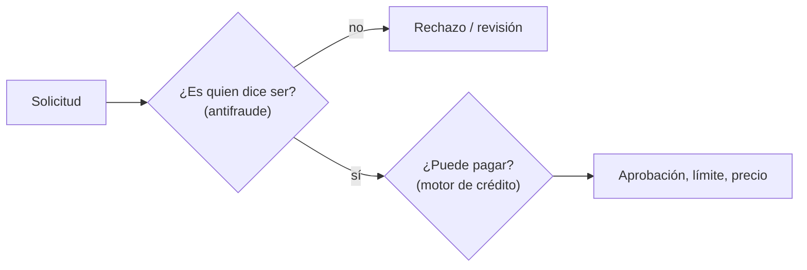

# Guía del lab (para no perderse)

Esta guía explica **qué estamos haciendo, con qué y por qué**, sesión por sesión, en palabras simples. Cada paso sigue el mismo orden:

> **Ahora vamos a…** lo que se hace · **Para esto hay que saber…** los conceptos · **Lo que salió** el resultado

Doy por sabido lo que un analista de riesgo de crédito ya maneja (regresión logística, LightGBM, AUC, Gini, KS, PD, cosechas). Lo nuevo es lo propio del fraude, y cuando hay una analogía con crédito la uso. Los términos sueltos están en el [glosario](glosario.md).

---

## Primero: ¿en qué se diferencia el fraude del riesgo de crédito?

En crédito la pregunta es **"¿esta persona va a poder pagar?"**. En fraude es **"¿esta persona es quien dice ser y viene de buena fe?"**. Se parecen (los dos son clasificación binaria con pocos positivos), pero cambian cosas importantes:

| | Riesgo de crédito | Fraude |
|---|---|---|
| Quién es el "malo" | Un cliente real que no puede pagar | Alguien que **engaña a propósito** (identidad falsa, robada, mulas) |
| Tasa de positivos | 10–20% de mora en Lending Club | **~1%** o menos (BAF 1,1%; PaySim 0,13%) |
| ¿Se adapta el malo? | No: el deudor no estudia tu modelo | **Sí**: el defraudador prueba hasta que pasa. Los patrones cambian rápido |
| Qué variables pesan | Ingreso, deuda, historial | **Comportamiento**: velocidad de solicitudes, dispositivo, correo, sesión |
| Cuándo llega la etiqueta | Meses (hay que esperar la mora) | Días o semanas (contracargo, reclamo de la víctima) |
| Costo de equivocarse | Prestarle a quien no paga | Dejar pasar el fraude **o molestar al cliente bueno** (fricción) |

Y lo más importante para este lab: **un buen puntaje de crédito no protege contra el fraude**. En BAF el fraude es mayor justo donde el puntaje es mejor (sesión 1). Por eso en la práctica hay **dos filtros en serie**: primero el antifraude, después el de crédito.

---

## Sesión 1 ✅ · Datos y pregunta de negocio

### Paso 1. Elegir los datos

**Ahora vamos a…** conseguir datos de fraude, porque Lending Club (el dataset del lab de crédito) no dice qué préstamos fueron fraude.

**Para esto hay que saber…**

- **Los datos reales de fraude casi nunca son públicos.** Un banco no publica quién lo estafó ni cómo lo detecta. Por eso los datasets buenos son **sintéticos**: se generan imitando datos reales.
  - **GAN** (red generativa adversaria): dos redes compiten, una inventa filas falsas y la otra intenta distinguirlas de las reales; al final las inventadas se parecen mucho a las reales sin copiar a nadie. Así se hizo **BAF**.
  - **Simulación por agentes**: se programan "personas" y "cuentas" que hacen transacciones según reglas calibradas con datos reales, y se meten defraudadores o lavadores. Así se hicieron **PaySim** e **IBM AML**.
- **La licencia decide qué se puede subir al repo.** "CC BY" = puedes usarlo citando la fuente; "NC" = no comercial; "SA" = lo que publiques va con la misma licencia; "**ND** = sin derivados" (no puedes publicar nada transformado). Por "ND" quedó fuera Elliptic.

**Lo que salió:** tres fuentes, una por cada momento del fraude.

| Momento | Dataset | Qué es cada fila |
|---|---|---|
| **Entrada** (alguien abre una cuenta) | BAF | una solicitud de apertura de cuenta bancaria por internet |
| **Uso** (mueve plata) | PaySim | una transacción de billetera móvil (tipo Nequi o Yape) |
| **Escondite** (blanquea plata) | IBM AML | una transferencia entre cuentas de distintos bancos |

### Paso 2. Guardar todo en Parquet y consultarlo con DuckDB

**Ahora vamos a…** convertir 2,3 GB de CSV en algo rápido de consultar.

**Para esto hay que saber…**

- **Parquet** es un formato de archivo que guarda los datos **por columnas** y comprimidos. Si preguntas "¿cuál es la tasa de fraude?", solo lee la columna `fraud_bool` y no todo el archivo. Los 2,3 GB de CSV quedaron en 659 MB.
- **DuckDB** es SQL que corre dentro de Python, sin instalar un servidor. Lee los Parquet directamente como si fueran tablas.
- La conexión es de **solo lectura** a propósito: más adelante el agente de IA escribirá SQL, y así no puede borrar ni leer nada fuera de los datos.

### Paso 3. Publicar una muestra con peso

**Ahora vamos a…** subir datos al repo para que cualquiera pueda correrlo, pero GitHub no acepta archivos tan grandes.

**Para esto hay que saber…**

- **Muestreo estratificado:** en vez de tomar filas al azar (y quedarnos con poquísimos fraudes), guardamos **todos los fraudes** y 1 de cada 10 solicitudes sanas.
- **Peso:** cada sana de la muestra "representa" a 10 de la población, así que lleva `peso = 10`; cada fraude lleva `peso = 1`. Sumando pesos se recupera la población (≈ 1 M) y la tasa real (1,10%). Es la misma idea de una encuesta con factores de expansión.

### Paso 4. Mirar los datos y decidir

**Lo que salió** (notebook 01):

- **Fraude ≠ crédito:** 0,5% de fraude en el 10% de peor puntaje de crédito y 3,4% en el 10% de mejor puntaje.
- **Edad:** 0,4% de fraude a los 20 años y 5,3% a los 90. Un modelo podría castigar a los mayores (tema de *fairness*, sesión 4).
- **PaySim:** solo hay fraude en transferencias y retiros (`TRANSFER`, `CASH_OUT`).
- **IBM AML:** el lavado tiene "formas" en la red (ciclos, abanicos), y se ve mirando conexiones, no transacciones sueltas.

**Qué decidí** ([decisión 001](decisiones.md)): hacer el ciclo completo con BAF como eje, y medir en dos niveles: uno técnico (cuánto fraude atrapo molestando a 5 de cada 100 clientes buenos) y otro en dinero (pérdida neta evitada).

---

## Sesión 2 · Primer modelo sobre BAF (próxima)

**Ahora vamos a…** entrenar el primer modelo que, dada una solicitud de cuenta, diga qué tan probable es que sea fraude, y medir cuánto fraude atrapa.

### Para esto hay que saber…

**1. Qué es BAF (Bank Account Fraud)**

- Lo publicó **Feedzai**, una empresa de antifraude, en NeurIPS 2022 (la conferencia de machine learning más grande). Parte de solicitudes **reales** de apertura de cuenta bancaria online de un banco que no se nombra, regeneradas con una GAN y con ruido para que nadie sea identificable.
- **1 millón de solicitudes en 8 meses** (`month` 0 a 7), con **1,1% de fraude** (`fraud_bool = 1`). Fraude aquí significa abrir la cuenta con identidad falsa o robada, normalmente para usarla en estafas o como "cuenta mula".
- Trae **6 versiones**: la base y 5 variantes con **sesgos inyectados a propósito** respecto a la edad (por ejemplo, menos mayores de 50, o más fraude entre ellos). Sirven para probar si un modelo se vuelve injusto. En la sesión 2 usamos solo la base; las variantes son de la sesión 4.

**2. Qué variables trae** (30 variables, más el mes y la etiqueta). Se agrupan así:

| Grupo | Ejemplos | Intuición |
|---|---|---|
| Perfil | `income`, `customer_age`, `employment_status`, `housing_status` | Lo mismo que en crédito, pero en rangos (edad en décadas, ingreso en deciles) para proteger a las personas |
| Crédito | `credit_risk_score`, `proposed_credit_limit`, `has_other_cards` | El puente con el lab de crédito |
| **Velocidad** | `velocity_6h`, `velocity_24h`, `zip_count_4w`, `date_of_birth_distinct_emails_4w` | ¿Cuántas solicitudes llegan en poco tiempo? El defraudador trabaja en ráfagas, con muchas solicitudes seguidas |
| **Identidad** | `name_email_similarity`, `email_is_free`, `phone_home_valid`, `phone_mobile_valid` | ¿El correo se parece al nombre? `juan.perez@` sí; `xk29ab@` no |
| **Dispositivo y sesión** | `device_os`, `device_distinct_emails_8w`, `session_length_in_minutes`, `keep_alive_session`, `foreign_request` | ¿El mismo celular abrió cuentas con muchos correos distintos? ¿La solicitud viene del extranjero? |

Detalles a cuidar:
- Los valores **−1 (o negativos) significan "dato faltante"**, no cero. Por ejemplo, `prev_address_months_count` viene en −1 en el 71% de las filas.
- `device_fraud_count` vale 0 en todas las filas: no aporta nada y se elimina.

**3. Partición temporal (como el OOT de crédito)**

Entrenamos con los meses **0–5** y probamos con los **6–7**, tal como propone el paper. Es el mismo principio del *out-of-time* en crédito: el modelo se usa en el futuro, así que se evalúa en el futuro. En fraude importa todavía más porque el defraudador cambia de táctica, y en BAF el fraude sube del 0,9% en el mes 2 al 1,5% en el mes 7.

**4. La métrica: recall con 5% de falsos positivos**

Ya conoces AUC; aquí usamos otra porque mide **la operación**, no el ranking completo.

- **Falso positivo (FPR):** de cada 100 clientes **buenos**, ¿a cuántos marco como sospechosos? Fijamos 5 (5%). Esos 5 sufren fricción: les piden documentos, los llaman o los rechazan.
- **Recall (sensibilidad):** de cada 100 **fraudes**, ¿cuántos atrapo con ese corte?
- Entonces la pregunta es: *"si acepto molestar a 5 de cada 100 buenos, ¿qué porcentaje del fraude atrapo?"*. Es un punto concreto de la curva ROC: el que importa para operar.

**5. El desbalance (1,1% de positivos)**

- Con tan pocos fraudes, la **precisión** siempre será baja: aunque el modelo sea bueno, la mayoría de las alertas serán clientes buenos, simplemente porque hay 90 buenos por cada fraude. Es normal y no indica un mal modelo.
- No vamos a "inventar fraudes" (SMOTE) ni a botar buenos: con LightGBM basta ajustar el **peso de la clase** o directamente el umbral, y la métrica a 5% de FPR ya tiene en cuenta el desbalance.

**6. Lo que ya sabes y aplica igual:** regresión logística como línea base interpretable, LightGBM como campeón probable, AUC como métrica secundaria y deciles de score para ver el ordenamiento.

### Lo que vas a decidir tú en la sesión 2

- **¿Entra la edad (`customer_age`) al modelo?** Mejora la detección, pero es un atributo protegido. Es la primera decisión de fairness.
- **¿Qué modelo queda de campeón?** Se decide comparando recall con 5% de FPR y la estabilidad entre los meses 6 y 7.

### Lo que va a salir

- Notebook 02 con la línea base (logística) y LightGBM.
- Recall con 5% de FPR, AUC y deciles de score en los meses 6–7.
- Las variables que más pesan y si coinciden con la intuición (velocidad, dispositivo, correo).

---

## Lo que viene después (un renglón por sesión)

| Sesión | En simple |
|---|---|
| 3 · Costo y umbrales | ¿Dónde pongo el corte para perder menos plata, si revisar una alerta cuesta y molestar a un cliente bueno también? |
| 4 · Fairness | ¿El modelo marca más a los mayores de 50 sin razón? ¿Cuánto cuesta corregirlo? |
| 5 · Drift | ¿El modelo de enero sigue sirviendo en agosto? (como el PSI en crédito) |
| 6 · Explicabilidad | ¿Por qué marcó esta solicitud? Razones claras para el analista humano |
| 7 · Transacciones | Fraude en el uso de la cuenta (PaySim), sin hacer trampa con columnas que "delatan" la respuesta |
| 8 · Reglas + ML | Reglas fijas ("monto > X") contra un modelo, y cómo combinarlos |
| 9 · Grafos | El lavado se ve en las conexiones entre cuentas, no en una transacción sola |
| 10 · Tipologías | Reconocer las formas del lavado: ciclos, abanicos, embudos |
| 11 · Agente | Una IA que investiga una alerta, consulta los datos y propone; un humano decide |
| 12 · Operación | Exponer el lab como servidor MCP para que el agente de crédito lo use |
| 13 · Caso de negocio | Recomendación final de política antifraude y release v1.0.0 |
