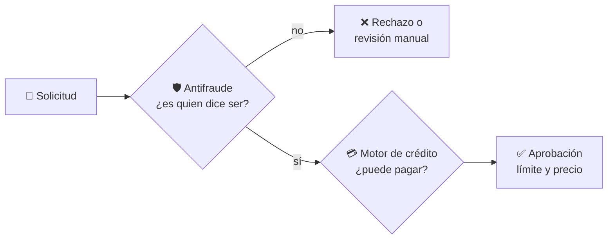
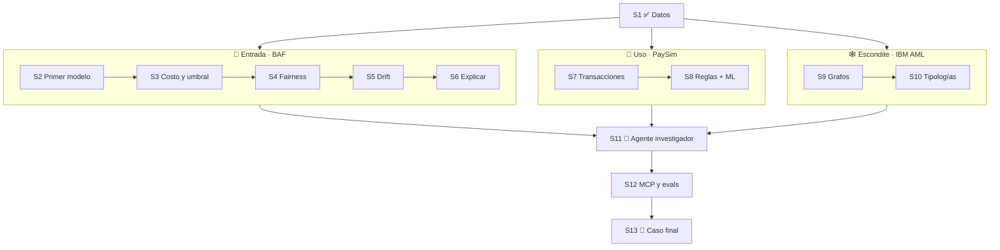
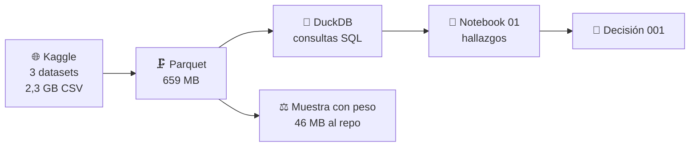
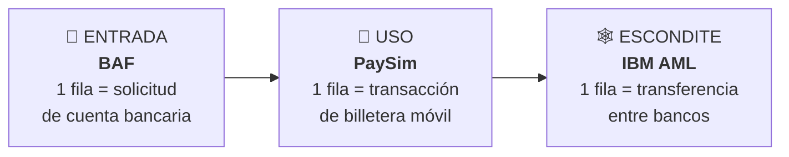
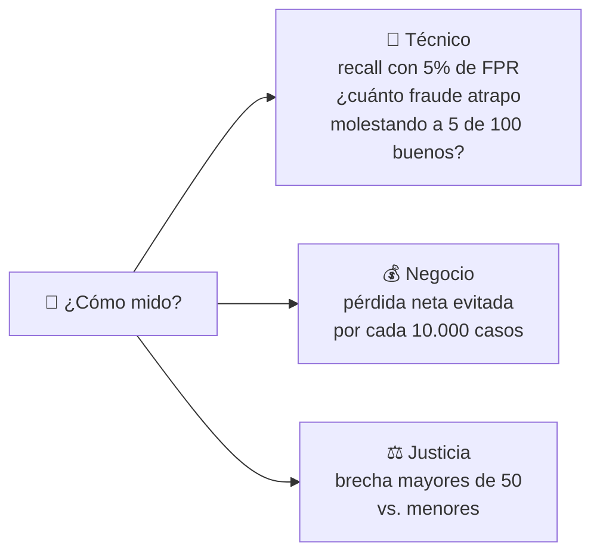
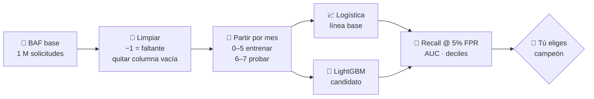
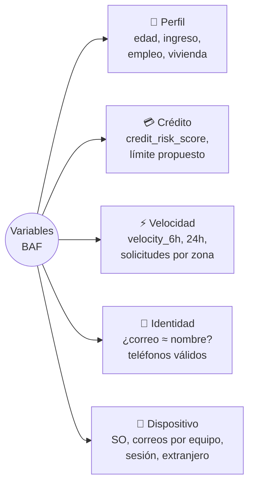
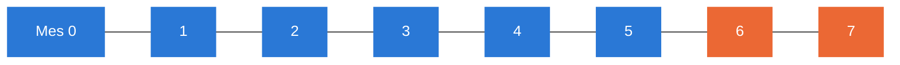
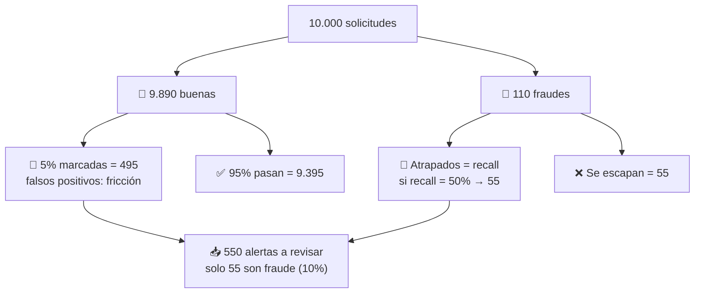

# 🧭 Guía del lab, paso a paso

> [!TIP]
> **Cómo leer esta guía.** Cada paso tiene siempre tres bloques:
>
> 🎯 **Ahora vamos a…** lo que se hace
> 📚 **Para esto hay que saber…** los conceptos, en simple
> ✅ **Lo que salió** el resultado
>
> No explico lo que ya se maneja en riesgo de crédito (logística, LightGBM, AUC, KS, PD). Las palabras nuevas están en el [glosario](glosario.md).

**Contenido**

1. [Fraude vs. riesgo de crédito](#1-fraude-vs-riesgo-de-crédito)
2. [Mapa del lab](#2-mapa-del-lab)
3. [Sesión 1: datos y pregunta de negocio](#3-sesión-1-datos-y-pregunta-de-negocio) ✅
4. [Sesión 2: primer modelo sobre BAF](#4-sesión-2-primer-modelo-sobre-baf) ⏭️ próxima
5. [Lo que viene después](#5-lo-que-viene-después)

---

## 1. Fraude vs. riesgo de crédito

Crédito pregunta **"¿puede pagar?"**. Fraude pregunta **"¿es quien dice ser y viene de buena fe?"**. Por eso en la vida real son **dos filtros en fila**:

**En qué cambia**

| | 💳 Crédito | 🛡️ Fraude |
|---|---|---|
| El "malo" | cliente que no puede pagar | alguien que **engaña a propósito** |
| % de malos | 10–20% | **~1%** o menos |
| ¿Se adapta? | no | **sí, prueba hasta que pasa** |
| Variables clave | ingreso, deuda | **comportamiento**: velocidad, dispositivo, correo |
| La etiqueta llega en | meses | días o semanas |
| Error caro | prestar a quien no paga | dejar pasar fraude **o molestar al bueno** |

> [!IMPORTANT]
> **Un buen puntaje de crédito no protege contra el fraude.** En BAF el fraude es **3,4%** en el 10% de **mejor** puntaje y **0,5%** en el de peor (sesión 1). El defraudador se disfraza de buen cliente.

---

## 2. Mapa del lab

---

## 3. Sesión 1: datos y pregunta de negocio

**Estado:** ✅ hecha

### Paso 1 · Elegir los datos

🎯 **Ahora vamos a…** conseguir datos de fraude, porque Lending Club (lab de crédito) no dice qué préstamo fue fraude.

📚 **Para esto hay que saber…**

- **Los datos reales de fraude casi nunca son públicos**: ningún banco publica cómo lo estafan. Los buenos datasets son **sintéticos**, es decir, imitan datos reales sin copiar a nadie. Se hacen de dos formas:
  - **GAN**: una red inventa filas y otra intenta pillarlas; al final las inventadas parecen reales → así nació **BAF**.
  - **Simulación**: se programan personas y cuentas que hacen transacciones, y se meten estafadores → **PaySim** e **IBM AML**.
- **La licencia decide qué se puede subir:**

| Sigla | Significa |
|---|---|
| BY | hay que citar la fuente |
| NC | solo uso no comercial |
| SA | lo que publiques va con la misma licencia |
| **ND** | **no se puede publicar nada transformado** → por eso quedó fuera Elliptic |

✅ **Lo que salió:** una fuente por cada momento del fraude.

### Paso 2 · Guardar en Parquet y consultar con DuckDB

🎯 **Ahora vamos a…** volver rápidos de consultar 2,3 GB de CSV.

📚 **Para esto hay que saber…**

- 🗜️ **Parquet** = archivo guardado **por columnas** y comprimido. Si preguntas la tasa de fraude, solo lee esa columna. Resultado: 2,3 GB → **659 MB**.
- 🦆 **DuckDB** = SQL dentro de Python, sin instalar servidor. Lee los Parquet como si fueran tablas.
- 🔒 La conexión es **de solo lectura** a propósito: más adelante el agente de IA escribirá SQL, y así no puede borrar nada.

### Paso 3 · Publicar una muestra con peso

🎯 **Ahora vamos a…** subir datos al repo, pero GitHub no acepta archivos tan grandes.

📚 **Para esto hay que saber…** es la idea de una encuesta con **factor de expansión**: guardamos **todos** los fraudes y 1 de cada 10 sanos, y cada sano "vale por 10".

| Caso | ¿Entra a la muestra? | Peso | Representa a |
|---|---|---|---|
| 🚨 Fraude | todos | 1 | 1 solicitud |
| 🙂 Sano | 1 de cada 10 | 10 | 10 solicitudes |

✅ **Lo que salió:** sumando pesos vuelve el millón de solicitudes y la tasa real de **1,10%**, en solo 46 MB.

### Paso 4 · Mirar los datos y decidir

✅ **Lo que salió** (notebook 01):

> [!NOTE]
> 💳 **Fraude ≠ crédito:** 0,5% de fraude en el peor decil de puntaje → **3,4%** en el mejor.
>
> 👵 **Edad:** 0,4% a los 20 años → **5,3%** a los 90. Riesgo de que el modelo castigue a los mayores (sesión 4).
>
> 💸 **PaySim:** solo hay fraude en `TRANSFER` y `CASH_OUT`.
>
> 🕸️ **IBM AML:** el lavado tiene "formas" en la red (ciclos, abanicos) que no se ven mirando una transferencia sola.

📌 **Qué decidí** ([decisión 001](decisiones.md)): ciclo completo con BAF como eje, medido en tres frentes:

---

## 4. Sesión 2: primer modelo sobre BAF

**Estado:** ⏭️ próxima

🎯 **Ahora vamos a…** entrenar el primer modelo que, dada una solicitud de cuenta, diga qué tan probable es que sea fraude, y medir cuánto fraude atrapa.

### 📚 Para esto hay que saber…

#### ① Qué es BAF

| Ficha | |
|---|---|
| **Nombre** | Bank Account Fraud |
| **Quién** | Feedzai (empresa antifraude), NeurIPS 2022 |
| **Origen** | solicitudes **reales** de cuenta bancaria online, regeneradas con GAN + ruido |
| **Tamaño** | 1 millón de solicitudes · 8 meses (`month` 0–7) |
| **Fraude** | **1,1%**: cuentas abiertas con identidad falsa o robada, casi siempre para usarlas como **cuenta mula** |
| **Versiones** | base + 5 variantes con **sesgo de edad inyectado a propósito** (se usan en la sesión 4) |

#### ② Qué variables trae (30 + mes + etiqueta)

| Grupo | La intuición |
|---|---|
| ⚡ Velocidad | el defraudador trabaja **en ráfagas**: muchas solicitudes seguidas (≈ consultas recientes al buró) |
| 🪪 Identidad | `juan.perez@…` encaja con "Juan Pérez"; `xk29ab@…` no |
| 📱 Dispositivo | un mismo celular que abre cuentas con muchos correos distintos es sospechoso |
| 👤 Perfil | edad e ingreso vienen en rangos (décadas, deciles) para proteger a las personas |

> [!WARNING]
> **Detalles a cuidar al limpiar**
> - Los valores **−1 (o negativos) significan "faltante"**, no cero. Ej.: `prev_address_months_count` viene en −1 en el **71%** de las filas.
> - `device_fraud_count` vale 0 en todas las filas → no aporta nada, se elimina.

#### ③ Partición por tiempo (tu *out-of-time* de crédito)

🔵 Entrenar con los meses 0–5 · 🟠 Probar con 6–7. El modelo se usa en el futuro, así que se evalúa en el futuro. En fraude importa todavía más porque el estafador cambia: en BAF el fraude sube de **0,9%** (mes 2) a **1,5%** (mes 7).

#### ④ La métrica: recall con 5% de falsos positivos

Es **un punto de la curva ROC**: el que importa para operar. Con un ejemplo de 10.000 solicitudes:

> [!NOTE]
> El 50% es **un número de ejemplo**, no un resultado. La sesión 2 mide el real.

- **FPR 5%** = de cada 100 clientes buenos, molesto a 5 (documentos, llamada, rechazo).
- **Recall** = de cada 100 fraudes, cuántos atrapo con ese corte.

#### ⑤ El desbalance: solo 1,1% de fraudes

> [!TIP]
> En el ejemplo de arriba, **9 de cada 10 alertas son clientes buenos aunque el modelo sea bueno**. No es un error: hay 90 buenos por cada fraude. Por eso no juzgamos el modelo por su precisión.
>
> No vamos a inventar fraudes artificiales (SMOTE): basta con ajustar el peso de la clase en LightGBM y fijar el corte por FPR.

### 📌 Lo que vas a decidir tú

- [ ] **¿Entra la edad (`customer_age`) al modelo?** Ayuda a detectar, pero es un atributo protegido. Es tu primera decisión de fairness.
- [ ] **¿Qué modelo queda de campeón?** Comparando recall con 5% de FPR y qué tan estable es entre el mes 6 y el 7.

### 📦 Lo que va a salir

- [ ] Notebook 02 con logística y LightGBM
- [ ] Recall con 5% de FPR, AUC y deciles en los meses 6–7
- [ ] Las variables que más pesan, y si coinciden con la intuición

---

## 5. Lo que viene después

| Sesión | La pregunta en simple |
|---|---|
| 3 💰 Costo | ¿Dónde pongo el corte para perder menos plata? |
| 4 ⚖️ Fairness | ¿El modelo marca de más a los mayores de 50? |
| 5 📉 Drift | ¿El modelo de enero sirve en agosto? (≈ PSI) |
| 6 🔍 Explicar | ¿Por qué marcó esta solicitud? |
| 7 💸 Transacciones | ¿Cómo detecto fraude en el uso sin hacer trampa? |
| 8 📏 Reglas + ML | ¿Reglas fijas, modelo, o los dos? |
| 9 🕸️ Grafos | ¿Cómo se ve el lavado en las conexiones? |
| 10 🔁 Tipologías | ¿Reconozco ciclos, abanicos y embudos? |
| 11 🤖 Agente | ¿Una IA puede investigar una alerta? (un humano decide) |
| 12 🔌 MCP | ¿El agente de crédito puede consultar este lab? |
| 13 🏁 Caso final | ¿Qué política antifraude recomiendo? |
